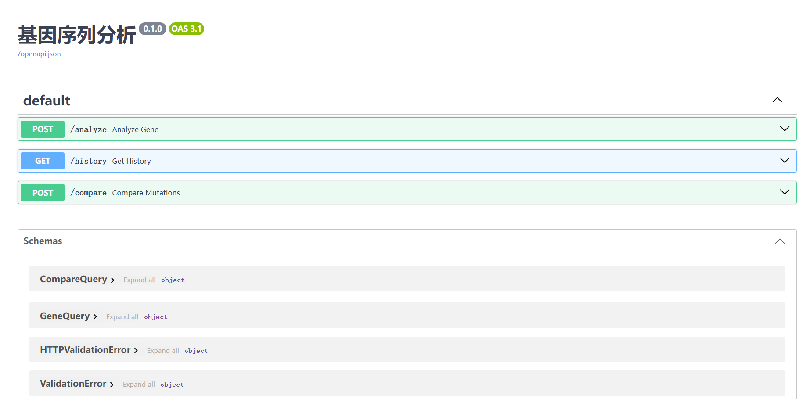
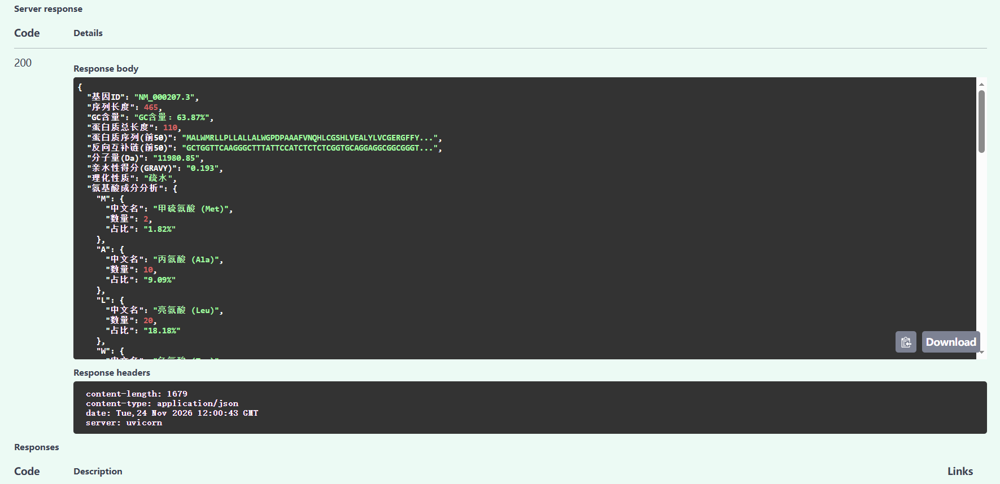
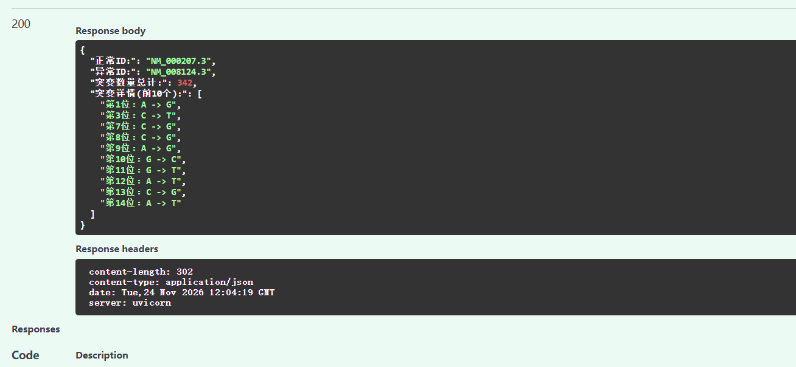
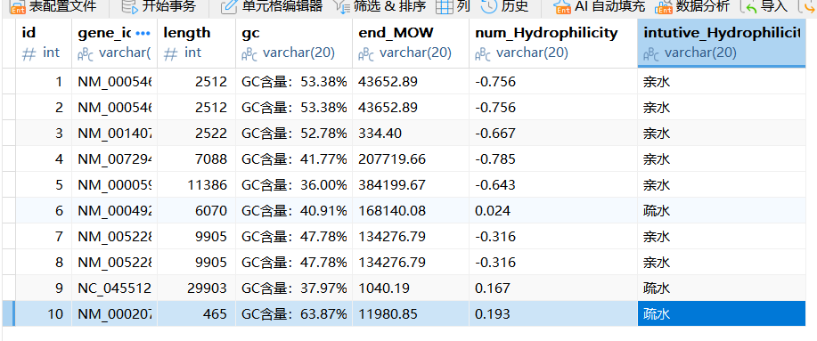
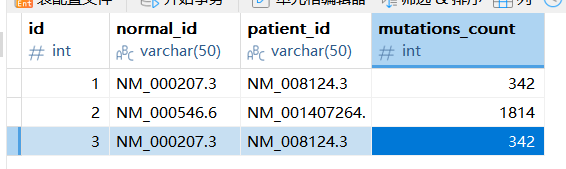

# 基因序列分析微服务后端系统

## 项目简介
本项目是一个基于 Python FastAPI 框架构建的生物信息学微服务后端系统。系统通过调用 NCBI 官方 E-utilities API 获取真实基因序列数据，并在本地实现生信算法分析与数据持久化。

## 技术栈
- 开发语言：Python 3.10
- Web 框架：FastAPI, Uvicorn
- 数据库：MySQL, PyMySQL
- 数据校验：Pydantic
- 数据源：NCBI E-utilities API

## 核心功能
1. 单基因深度分析 (POST /analyze)
- 自动从 NCBI 拉取 FASTA 格式 DNA 序列。
- 计算 GC 含量与序列长度。
- 实现 DNA 翻译为蛋白质序列、反向互补链生成算法。
- 蛋白质理化性质计算：分子量估算、疏水性 (GRAVY) 分析、氨基酸成分占比。
- 数据持久化：将分析核心指标存入 MySQL 数据库。

2. 双基因突变比对 (POST /compare)
- 支持输入正常基因 ID 与异常基因 ID。
- 双序列逐位比对，输出单核苷酸多态性 (SNP) 变异位点。
- 自动将比对记录存入数据库。

3. 历史记录查询 (GET /history & GET /compare_history)
- 从 MySQL 数据库中读取单基因分析与突变比对的历史操作记录。

## 运行截图
系统接口全览：

单基因深度分析返回结果：

双基因突变对比返回结果：

MySQL数据库记录-单基因分析(history表)：

MySQL数据库记录-双基因突变对比分析(compare_history表)：

## 本地运行指南
1. 安装依赖：`pip install fastapi uvicorn pymysql requests pydantic`
2. 确保本地 MySQL 已创建 `fastapi_db` 数据库及对应数据表。
3. 启动服务：`python -m uvicorn sx_first_try:app --reload`
4. 访问接口文档：`http://127.0.0.1:8000/docs`